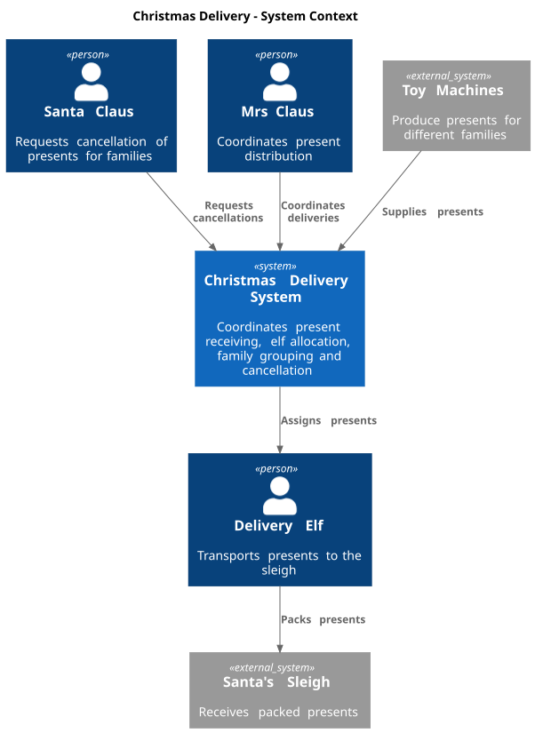

# 3. System Scope and Context

## 3.1 Context Diagram

The C4 System Context diagram shows the Christmas Delivery system in its environment, including external actors and systems.

## 3.2 Business Context

The Christmas Delivery system simulates the production and delivery of presents for Santa Claus's journey. The business context is defined by four core user stories from the original kata:

### User Story 1: Single Elf Packing
A single elf takes presents from a toy machine and packs them onto Santa's sleigh. The elf becomes available again after completing the packing operation.

### User Story 2: Mrs Claus Coordination
Mrs Claus receives presents from multiple toy machines and assigns them to available elves. When no elf is available, she holds the presents until an elf becomes available.

### User Story 3: Family Grouping
Presents belong to families, each with 1..N presents. Presents may arrive interleaved. Group presents by family where possible, while avoiding unnecessary elf idle time.

### User Story 4: Cancellation Handling
Santa may request that Mrs Claus discard presents belonging to cancelled families.

## 3.3 Technical Context

### System Boundary

The Christmas Delivery system includes:

- **Present Management**: Handles present reception, tracking, and inventory
- **Delivery Scheduling**: Coordinates Mrs Claus's present assignment logic
- **Sleigh Management**: Manages sleigh loading and elf delivery operations

The system excludes:

- Toy machine implementation (externally provided)
- Santa's sleigh mechanics (externally provided)
- Family management outside of present grouping
- Persistent data storage

### External Systems

| System | Interaction | Responsibility |
|---|---|---|
| **Toy Machines** | Supplies presents | Produces presents for different families |
| **Santa's Sleigh** | Receives packed presents | External system for present delivery |
| **Santa (person)** | Requests cancellations | Initiates present cancellations for families |
| **Mrs Claus (person)** | Coordinates deliveries | Manages present-to-elf assignment |
| **Delivery Elf (person)** | Packs presents | Transports presents to sleigh |

### Technical Interfaces

| Interface | Direction | Description |
|---|---|---|
| Present supply | External → System | Toy machines provide presents with family information |
| Sleigh loading | System → External | Packaged presents delivered to sleigh |
| Cancellation request | External → System | Santa requests present cancellation for families |
| Assignment notification | System → External | Mrs Claus assigns presents to elves |

## 3.4 Stakeholders

| Stakeholder | Relationship | Interests |
|---|---|---|
| **Santa Claus** | External actor | Requests cancellation of presents for families |
| **Mrs Claus** | External actor | Coordinates present distribution and elf assignment |
| **Delivery Elf** | External actor | Packs presents onto Santa's sleigh |
| **Toy Machines** | External system | Supplies presents to the Christmas Delivery system |
| **Santa's Sleigh** | External system | Receives packed presents for delivery |

## 3.5 Assumptions and Dependencies

### Assumptions

| Assumption | Rationale |
|---|---|
| Family grouping is based on family name/ID only | No geographic or address data in original kata |
| Present arrivals are discrete events | No continuous flow or batch processing specified |

### Dependencies

| Dependency | Description |
|---|---|
| Toy Machines | Must provide presents with family information |
| Santa's Sleigh | Must be ready to receive packed presents |
| External actors | Must initiate cancellation requests |

## 3.6 Scope Inclusions and Exclusions

### Inclusions

| Feature | Implementation Status |
|---|---|
| Present reception from toy machines | Included |
| Elf assignment and availability tracking | Included |
| Family grouping for presents | Included |
| Present cancellation handling | Included |
| Sleigh loading coordination | Included |
| Concurrent elf operations | Included |
| In-memory state management | Included |

### Exclusions

| Feature | Reason |
|---|---|
| Persistent storage | In-memory constraint per ADR-001 |
