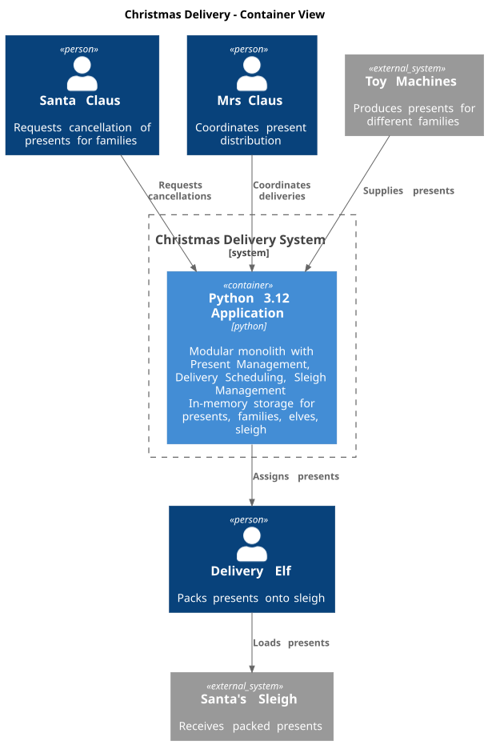
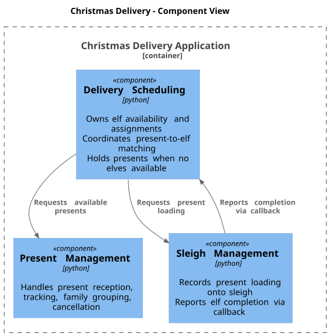

# 5. Building Block View

## 5.1 Container View

The C4 Container View shows the Christmas Delivery system as a single Python application container running on a host. The application contains all three internal components (Present Management, Delivery Scheduling, Sleigh Management) and uses in-memory data storage.

### Container: Christmas Delivery Application

| Property | Value |
|---|---|
| **Technology** | Python 3.12 |
| **Framework** | None (standard library only) |
| **Storage** | In-memory data structures |
| **Execution** | Single process |

This container encapsulates the entire system functionality. It receives presents from Toy Machines, coordinates Mrs Claus's assignment logic, tracks elf availability, and delivers presents to Santa's Sleigh.

## 5.2 Component View

The C4 Component View decomposes the Christmas Delivery application into three internal components with clear boundaries and responsibilities.

### Component: Present Management

**Responsibilities:**

- Present reception and tracking
- Present inventory management
- Family grouping
- Cancellation handling
- Availability status tracking

**Proposed Internal Interfaces:**

| Interface | Description |
|---|---|
| `receive_present(present_id, family_id)` | Add new present to inventory |
| `cancel_family_presents(family_id)` | Mark all family presents as cancelled |
| `get_available_presents()` | Return unassigned presents |
| `get_family_presents(family_id)` | Return all presents for a family |
| `get_all_families()` | Return all family IDs |

**Internal State:**

- `presents`: Dict[present_id, Present] - Present records
- `family_groups`: Dict[family_id, List[present_id]] - Grouped presents
- `cancelled_families`: Set[family_id] - Cancelled family IDs

**Dependencies:**

- None (core domain data management)

### Component: Delivery Scheduling

**Responsibilities:**

- Elf availability tracking and ownership
- Active elf assignments tracking
- Present-to-elf assignment coordination
- Present holding when no elves available

**Proposed Internal Interfaces:**

| Interface | Description |
|---|---|
| `assign_present_to_elf()` | Match available present to available elf |
| `get_available_elves()` | Return available elf IDs |
| `mark_elf_unavailable(elf_id)` | Mark elf as busy |
| `mark_elf_available(elf_id)` | Mark elf as available |
| `get_active_assignments()` | Return current elf-to-present mappings |

**Internal State:**

- `available_elves`: Set[elf_id] - Available elf IDs
- `busy_elves`: Dict[elf_id, present_id] - Elf present assignments
- `held_presents`: List[Present] - Presents waiting for elves

**Dependencies:**

- Present Management (for available presents)
- Sleigh Management (for elf completion signals via callback/interface)

### Component: Sleigh Management

**Responsibilities:**

- Sleigh loading operations
- Elf assignment completion tracking

**Proposed Internal Interfaces:**

| Interface | Description |
|---|---|
| `load_present(present_id, elf_id)` | Record present loading onto sleigh by elf |
| `elf_assignment_completed(elf_id)` | Notify Delivery Scheduling that elf is available |

**Internal State:**

- `loaded_presents`: List[Present] - Presents on sleigh

**Dependencies:**

- Delivery Scheduling (for assignment coordination;elf availability updates)

## 5.3 Component Dependencies

| Component | Depends On | Purpose |
|---|---|---|
| **Delivery Scheduling** | Present Management | Get available presents for assignment |
| **Delivery Scheduling** | Sleigh Management | Receive elf completion signals via callback/interface |
| **Sleigh Management** | Delivery Scheduling | Get active assignments and notify of completion |
| **Present Management** | — | Standalone (no dependencies) |

## 5.4 Shared State and Synchronization

### Shared State Areas

The three components share state through the in-memory data store:

| Shared State | Components | Purpose |
|---|---|---|
| Present inventory | Present Management, Delivery Scheduling | Track available presents for assignment |
| Elf availability | Delivery Scheduling | Owned by Delivery Scheduling |
| Loaded presents | Sleigh Management | Track presents on sleigh |

### Synchronization Requirements

**Thread-safe access** is required for shared state:

- Write operations to shared state must be protected
- Read operations may require consistency guarantees
- Concurrent assignment operations must prevent race conditions

**Synchronization implementation** (locks, conditions, queues) will be determined during implementation.

### Conflict Resolution

When conflicts arise (e.g., simultaneous cancellation and assignment):

- **Unresolved design detail:** The original kata does not define cancellation behavior for presents already assigned to elves.
- Implementation decision to be determined based on requirements clarification.

## 5.5 Component Boundaries

### Present Management Boundaries

- **Input**: Present receipt, cancellation requests
- **Output**: Available presents, family groups, cancellation status
- **Not responsible for**: Assignment logic, scheduling decisions

### Delivery Scheduling Boundaries

- **Input**: Available presents, elf completion signals
- **Output**: Present assignments, held presents, elf status
- **Not responsible for**: Present storage, sleigh loading operations
- **Owns**: Elf availability state and active assignments

### Sleigh Management Boundaries

- **Input**: Loaded presents, completion notifications
- **Output**: Loaded presents list
- **Not responsible for**: Assignment logic, present inventory
- **Handles**: Loading operations and elf completion signals

## 5.6 Alignment with User Stories

| User Story | Component Interaction |
|---|---|
| **US-1** Elf takes presents and packs onto sleigh | Delivery Scheduling assigns present → Sleigh Management records loading |
| **US-2** Mrs Claus coordinates, holds when no elves | Delivery Scheduling holds presents when no elves available |
| **US-3** Family grouping for presents | Present Management groups presents by family |
| **US-4** Cancellation handling | Present Management handles cancellation |
